# Architecture

## Overview

```
Browser ──► Next.js on Vercel ──────────────► Supabase
  │           • proxy.ts: refresh session,      • Postgres + Row Level Security (authorization source of truth)
  │             guard private routes            • Auth (email/password, invites, recovery, optional Google)
  │           • Server Components: reads         • Storage (private `documents`, public `avatars`/`branding`)
  │             as the user (RLS applies)        • Realtime (dashboards and notifications, RLS filtered)
  │           • Server Actions: zod validation,
  │             writes as the user (RLS applies)
  │           • Service role ONLY for: auth admin
  │             (invites/bans), public website API,
  │             payment webhooks (Phase 5)
  └── Realtime websocket (user JWT) ─────────────►
Public event website ──► /api/v1/* (event-scoped API key, Phase 5)
Payment gateway ───────► /api/v1/payments/webhook (signature verified, Phase 5)
```

**Principles**

1. **The database is the authorization boundary.** Every table has RLS. UI permission checks only decide what to *show*. Server actions run as the user, so a missing UI check still cannot leak or modify data.
2. **The service role is the exception.** It is wrapped in `src/lib/supabase/admin.ts` (`server-only`) and used only after an explicit `check_permission` RPC for the current user.
3. **Financial history is append-only.** Ledger rows are immutable and corrected with reversals or adjustments. Expense approvals and audit logs cannot be updated. ✅
4. **Tenancy is enforced, not trusted.** `college_id` is always derived from the event by trigger, `department_id` must belong to the row's event, and rows can never move between events. ✅

## Tenancy model

```
Super Admin (profiles.is_super_admin)
└── College            college_members (role: college_admin, …)
    └── Event          event_members   (role: event_admin, event_viewer, custom)
        └── Department department_members (position head / assistant_head / member + role)
```

Creating an event bootstraps its workspace through a trigger: `event_settings`, a `budgets` row, the 18 default departments and the 10 default sponsorship packages.

## Permission model

The permission matrix lives in the database as `roles × permissions → role_permissions`, and the Super Admin edits it under **Settings → Roles & permissions**. A user's effective permissions in an event are the union of four sources:

| Source | Applies to |
|---|---|
| `profiles.is_super_admin` | everything |
| `college_members.role_id` | the college and all of its events |
| `event_members.role_id` | the whole event |
| `department_members.role_id` | `department`-scoped permissions apply only in that department; `event`-scoped ones apply event-wide |

Because roles live in memberships, the same person can be Finance Head in one event and Media Head in another.

RLS policies use set-returning helpers such as `app.event_ids_with_permission('finance.view')` and `app.department_ids_with_permission('tasks.manage')`, wrapped in scalar sub-selects. Postgres evaluates them once per statement, not once per row, which keeps policies fast for tables with millions of rows across thousands of events. Boolean helpers (`app.has_event_permission`, `app.has_department_permission`) back SECURITY DEFINER RPCs.

The UI loads permissions through `my_access()` (memberships, for navigation and switchers) and `my_event_permissions(event)` (event-wide plus per-department keys).

## Frontend structure

- `src/app/(auth)`: login, forgot password, set/reset password (also used to accept invitations).
- `src/app/(app)`: the authenticated shell, with a black sidebar, a top bar (context switcher, breadcrumbs, ⌘K search, notifications, theme, profile) and the pages.
- `src/features/*`: feature modules. Each has `actions.ts` (server actions: zod → Supabase as the user → `revalidatePath`) and its client components.
- `src/components/ui`: the design system, built shadcn/ui-style on Radix and driven by the tokens in `src/app/globals.css`.
- Data tables use TanStack Table through one `DataTable` component that provides search, filters, sorting, pagination, column visibility, CSV export and empty states.
- Charts use Recharts with the brand tokens (lime, ink and greys), at most two series per chart, legends and tooltips.

## Entity relationship diagram (core)

```mermaid
erDiagram
  profiles ||--o{ college_members : has
  profiles ||--o{ event_members : has
  profiles ||--o{ department_members : has
  roles ||--o{ role_permissions : grants
  permissions ||--o{ role_permissions : in
  roles ||--o{ college_members : as
  roles ||--o{ event_members : as
  roles ||--o{ department_members : as
  colleges ||--o{ college_members : ""
  colleges ||--o{ events : runs
  events ||--|| event_settings : configures
  events ||--|| budgets : has
  events ||--o{ event_members : ""
  events ||--o{ departments : has
  departments ||--o{ department_members : ""
  departments ||--o| budget_allocations : funded_by
  events ||--o{ event_competitions : offers
  events ||--o{ registrations : receives
  registrations ||--o{ registration_items : includes
  registrations ||--o{ payments : paid_by
  payments ||--o{ payment_webhook_events : confirmed_by
  events ||--o{ financial_transactions : ledger
  payments ||--o| financial_transactions : books
  expense_requests ||--o{ expense_approvals : history
  expense_requests ||--o{ financial_transactions : paid_by
  departments ||--o{ expense_requests : submits
  vendors ||--o{ expense_requests : bills
  budgets ||--o{ budget_allocations : splits
  departments ||--o{ budget_revisions : requests
  events ||--o{ sponsors : courts
  sponsors ||--o{ sponsorship_deals : signs
  sponsorship_packages ||--o{ sponsorship_deals : tier
  sponsorship_deals ||--o{ sponsorship_payments : pays
  sponsorship_payments ||--o| financial_transactions : books
  sponsorship_deals ||--o{ sponsorship_deliverables : owes
  events ||--o{ tasks : has
  tasks ||--o{ task_assignments : assigned
  tasks ||--o{ task_comments : discussed
  tasks ||--o{ tasks : subtasks
  events ||--o{ documents : stores
  events ||--o{ venues : uses
  events ||--o{ event_schedules : schedules
  events ||--o{ inventory : tracks
  events ||--o{ media_assets : produces
  events ||--o{ marketing_campaigns : runs
  events ||--o{ announcements : posts
  profiles ||--o{ notifications : receives
  events ||--o{ api_credentials : integrates
  api_credentials ||--o{ api_integration_logs : logs
  events ||--o{ activity_log : feeds
```



Every event-scoped table carries `event_id` and `college_id` (derived), UUID primary keys, `created_at`/`updated_at`, foreign keys with `restrict` on financial paths, and covering indexes for its main access paths. See `docs/database.md`.

## Phase plan

1. Foundation ✅
2. Administration ✅
3. Departments: department list/dashboard, head and assistant appointment (history kept), team management, per-department permission view ✅
4. Finance: income recording/verification, expense workflow RPC (submit → review → approve/forward → pay), budgets and allocations with 75/90/100% warnings, ledger with reversals, exports ✅
5. Registrations: registration dashboard, participant search and filters, offline verification, cancellations and refunds; `/api/v1` endpoints, API key management, payment webhook with signature verification and idempotency ✅
6. Sponsorship: CRM, pipeline, packages, payments (verification books ledger income), deliverables ✅
7. Operations: tasks (Kanban, list, calendar), media, marketing, venues, vendors, inventory, master schedule ✅
8. Communication: announcements, notifications fan-out, comments, documents (signed URLs) ✅
9. Reporting: 12 reports with filters and CSV/XLSX/PDF export, global reports, event closure and financial settlement ✅
10. Finalization: advisor review and fixes, nonce CSP, dependency audit, penetration-test checklist, deployment ✅ (load testing is not done yet; see `docs/security.md` for the pre-event checklist)
